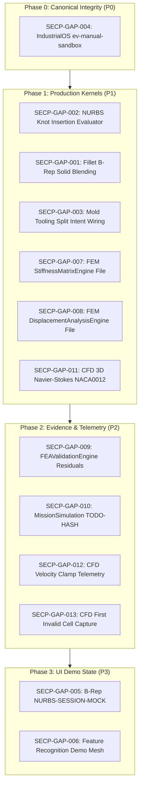

# SECP Engineering Gap Implementation Plan (POST-005 Roadmap)

**Mission ID:** `SECP-POST-FORENSIC-004-IMPLEMENTATION-PLAN`  
**Date:** 2026-09-23  
**Audit Standard:** Dependency-Ordered Engineering Execution Graph  

---

## 1. Implementation Philosophy

In accordance with forensic truth standards:
- **No speculative fixes.**
- **No hardcoded returns.**
- **Root gaps MUST be closed before derived contracts.**
- **P0 gaps (Canonical State Corruption) take absolute precedence.**

---

## 2. Dependency-Ordered Implementation Execution Phases

---

### Step 1: Phase 0 — Canonical State Corruption Remediation [P0]
1. **SECP-GAP-004 (`IndustrialOsV3Panel.tsx`):**
   - Eliminate hardcoded `'ev-manual-sandbox'`.
   - Capture real `id` from `evidenceBus.publishSync()` envelope.
   - Mutate object state exclusively with verifiable cryptographic envelope hash.
   - Prove with regression test that no mock string enters `osInstance['registry']`.

---

### Step 2: Phase 1 — Production Kernel Capability Closures [P1]
1. **SECP-GAP-002 (`NurbsKnotInsertion.ts`):**
   - Replace dummy `evaluate: (param) => ({ x: 0, y: 0, z: 0 })` with real evaluation via `NurbsBasis.evaluateCurvePoint(degree, knots, controlPoints, u)`.
   - Verify $C^0$ / $C^1$ geometric equivalence between pre- and post-knot insertion curves across 100 sample points.
2. **SECP-GAP-001 (`FilletEngine.ts` & `DesignToolContractRegistry.ts`):**
   - Implement real B-Rep cylindrical fillet blending between adjacent faces on manifold edges.
   - Generate topological blend faces, stitch into shell, update B-Rep document.
   - Reconnect `DesignToolContractRegistry` `FEATURE_FILLET` contract to canonical mutation pipeline.
3. **SECP-GAP-003 (`DesignToolContractRegistry.ts` Mold Split):**
   - Connect `MOLD_TOOLING_SPLIT` command to `MoldEngine.performMoldSplit`.
   - Dispatch real B-Rep body generation for Core and Cavity into CAD Document.
4. **SECP-GAP-007 & SECP-GAP-008 (FEM Manifest Files):**
   - Create `StiffnessMatrixEngine.ts` (element & global stiffness matrix utilities).
   - Create `DisplacementAnalysisEngine.ts` (post-processing displacement gradients and fields).
   - Verify alignment with `StructuralPhysicsManifest.ts`.
5. **SECP-GAP-011 (CFD NACA0012 Physical Validation):**
   - Perform grid sensitivity analysis and boundary condition audit on transonic aerofoil.

---

### Step 3: Phase 2 — Evidence, Validation & Telemetry Rigor [P2]
1. **SECP-GAP-009 (`FEAValidationEngine.ts`):**
   - Implement real residual norms: $||K u - F|| / ||F|| < 10^{-6}$.
   - Validate reaction force equilibrium and strain energy bounds.
2. **SECP-GAP-010 (`MissionSimulationEngine.ts`):**
   - Compute SHA-256 over trajectory segments and requirement evaluation records.
   - Bridge flight control loop with deterministic dynamics integrator.
3. **SECP-GAP-012 & SECP-GAP-013 (CFD Telemetry Instrumentation):**
   - In `Fvm3DNavierStokesSolver.ts`, increment `limiters.velocityClamped++` on cell velocity capping.
   - Export `velocityClamped` in `ConvergenceAudit3D`.
   - On non-finite value detection, capture `firstInvalidCell: { cellId: c, u, v, w, p }` into structured diagnostic failure envelope before throwing.

---

### Step 4: Phase 3 — UI Demo State Clarification [P3]
1. **SECP-GAP-005 & SECP-GAP-006:**
   - Standardize initial panel empty states or document-driven fixtures.
